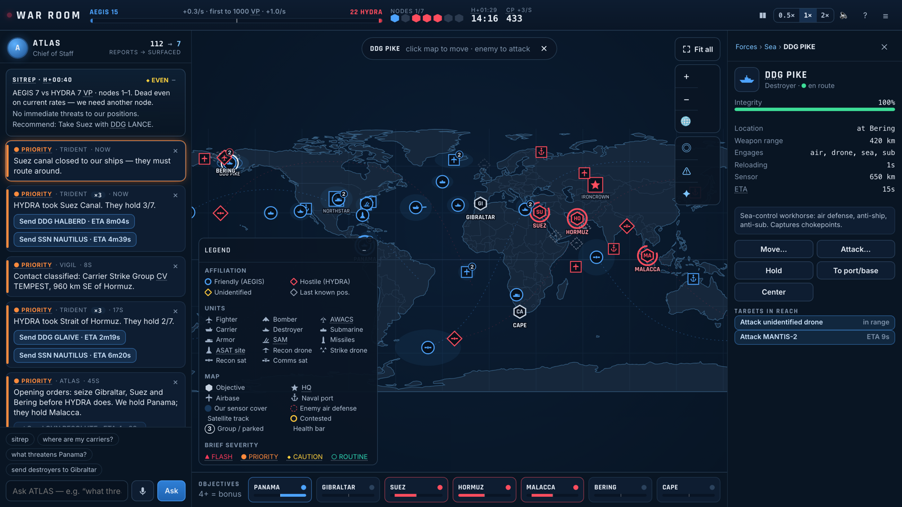
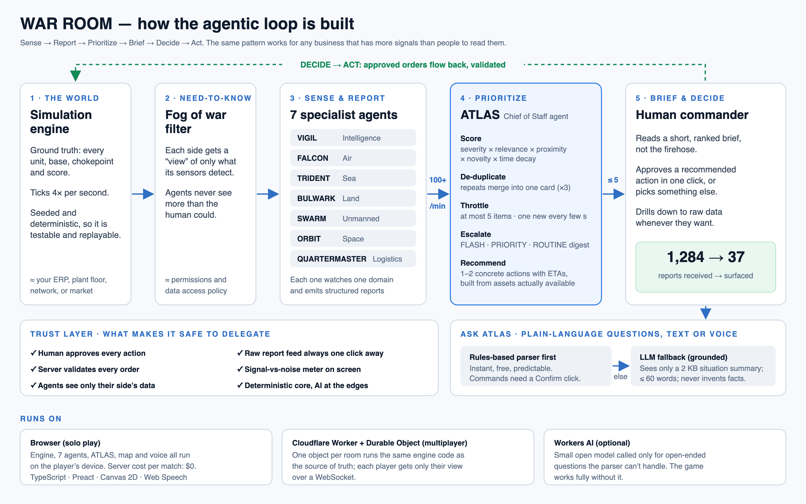

<!--
LinkedIn publishing notes (not part of the article):
- Main media: a video of a live game.
- LinkedIn does not render Markdown images: upload war-room-in-action.png and architecture.png
  where they appear below.
- Suggested headline (≤ 100 chars) is the H1 below. Suggested post to share the article is at the end.
-->

# Your Staff Reads 500 Reports a Minute. You Can Only Handle Five. What a War Game Teaches About Agentic AI

**Most leaders aren't short of data. They're short of attention.** I built a game to show what happens when AI agents take on the reading and the human keeps the deciding.

**Play it now in your browser: [war-room.troche.workers.dev](https://war-room.troche.workers.dev)**

---

## The problem every executive already has

Picture a theater commander in a crisis. Seven specialist teams watch air, sea, land, drones, space, intelligence and logistics. Each produces a steady stream of updates. In a busy hour that stream runs past 100 reports a minute.

No human can read all of it. Usually one of two things happens:

1. **The leader drowns.** Everything looks urgent, so nothing gets the attention it needs.
2. **The leader goes blind.** Filters get so aggressive that the one report that mattered never arrives.

Swap "theater commander" for COO, CISO, hospital chief medical officer, head of supply chain or plant manager, and nothing else changes. It's the same problem.

**WAR ROOM** is a real-time strategy game I built to make this problem, and one way to solve it, something you can feel in 15 minutes. It runs in a browser on desktop or phone, so there's nothing to install: [war-room.troche.workers.dev](https://war-room.troche.workers.dev).

---

## What the game is

You command a fictional coalition on a real map of the Earth. The goal is to control seven strategic chokepoints: Panama, Gibraltar, Suez, Hormuz, Malacca, the Bering Strait and a ground station. An AI opponent is trying to do the same.

The twist is that **you don't micromanage, you lead a staff of AI agents.**

- **Seven specialist agents** (callsigns VIGIL, FALCON, TRIDENT, BULWARK, SWARM, ORBIT and QUARTERMASTER) each watch one domain and report everything they see. By design, they report *a lot*.
- **ATLAS, the Chief of Staff agent**, reads every report and decides what deserves your attention. It hands you a short ranked brief of **five items at most**, each with one or two concrete recommended actions you can approve in one click.
- **You decide.** You can approve ATLAS's recommendation, pick something else, or ask a question in plain English by text or voice: *"What threatens Panama?"*, *"Send destroyers to Gibraltar."*

A counter on screen sums up the whole idea, for example **"1,284 reports → 37 surfaced."** That ratio is what the staff is worth to you.

---

## What it teaches: five lessons about agentic AI

### 1. The valuable agent is the one that *filters*, not the one that *generates*

We're used to judging AI by what it produces: words, code, images. In operations, the scarce resource is the decision-maker's attention, so the most valuable agent is the one that **decides what not to show you.**

ATLAS scores every report on five factors:

> **priority = severity × relevance to objectives × proximity to what you care about × novelty × freshness**

Repeats merge into a single card ("×3") instead of showing up as new alerts. Low-level routine updates roll into a digest. Only critical items (FLASH) can interrupt; everything else waits its turn. You end up looking at a handful of things that matter, not a wall of alerts.

**Strategic takeaway:** when you assess an AI initiative, measure how much it *reduces* what people have to read, not how much it produces.

### 2. A recommendation without an action button is just another report

Every item ATLAS surfaces comes with something you can do about it: *"Send destroyer HALBERD to Suez, ETA 8m04s."* The recommendation is built from the forces you *actually have available right now*, with real travel times, so it isn't generic advice.

That turns the loop from *read → think → go find the right screen → issue the order* into *read → approve*.

**Strategic takeaway:** design agents to produce **decision-ready options** that are specific, feasible and tied to an action, not insights that hand the work back to the human.

### 3. Specialists report, a coordinator prioritizes, a human decides

The architecture mirrors a well-run human organization:

- **Specialists** are narrow and thorough. Each knows one domain deeply.
- **A coordinator** (the Chief of Staff) knows the objectives and weighs across domains.
- **The executive** owns the decision and its consequences.

This is far easier to build, test and trust than one giant "do-everything" agent. When something goes wrong you can tell *which* agent got it wrong, and fix it.

**Strategic takeaway:** split agentic systems the way you'd split a team. Give each agent one job, give one agent responsibility for prioritizing, and keep the human accountable.

### 4. Trust comes from transparency, not from accuracy alone

ATLAS will sometimes rank things differently than you would. The game doesn't hide that. It earns trust with:

- **The raw firehose is always one click away.** Every report from every agent is in the Staff Traffic panel, so you can always check the work.
- **The signal-vs-noise meter** shows exactly how much was filtered.
- **Drill-down everywhere.** Any summary card opens the details behind it.

**Strategic takeaway:** people delegate to systems they can audit. Build the "show me why" path *before* you ask anyone to rely on the summary.

### 5. "Agentic" doesn't mean "an LLM everywhere"

This is the lesson that surprises technical audiences most. **The seven staff agents and ATLAS are not large language models.** They're fast, deterministic software: rules, scoring functions and planning logic. They run in the browser at no cost per decision, give the same answer every time, and are covered by unit tests.

A language model shows up in exactly one place: when you ask ATLAS an open-ended question the built-in parser doesn't understand. Even then it gets only a compact (under 2 KB) summary of what your side can see, has to answer in 60 words or fewer, and is told never to invent units, numbers or places. Commands still need a **Confirm** click. The game works fully with the model switched off.

**Strategic takeaway:** use deterministic logic where you need speed, cost control and predictability. Bring in generative AI where it adds something deterministic logic can't: language, ambiguity, open questions. And ground it tightly when you do.

---

## The architecture at a glance

**For executives, in one sentence:** the world produces data, a filter decides who's allowed to see what, specialists report, a chief of staff prioritizes and recommends, a human decides, and the decision flows back into the world.

**For technologists, the key design choices:**

- **World (simulation engine):** holds the ground truth and updates 4 times a second.
  *Worth copying:* it's deterministic and seeded, so any situation can be reproduced exactly for testing and debugging.
- **Need-to-know filter (fog of war):** each side gets a *view* containing only what its sensors detect.
  *Worth copying:* agents consume the same view the human does. They can't "cheat", and they can't leak what they shouldn't know.
- **Specialist agents:** compare consecutive views and emit structured reports: `{agent, severity, subject, location, text, actions}`.
  *Worth copying:* a structured report format, not free text, so the coordinator can score, merge and route reports.
- **ATLAS (coordinator):** scores, de-duplicates, throttles, escalates and recommends.
  *Worth copying:* explicit, tunable scoring weights, plus hard limits (5 items at most, one new item every few seconds, FLASH-only interrupts).
- **Course-of-action planner:** matches each threat to the nearest *available* capable assets, with travel times.
  *Worth copying:* recommendations are executable orders, so the button *is* the action.
- **Ask ATLAS:** natural language by text or voice.
  *Worth copying:* rules-based parser first, grounded LLM fallback second, and confirmation before any command.
- **Platform:** solo play runs entirely in the browser; multiplayer uses one Cloudflare Durable Object per game room as the source of truth.
  *Worth copying:* the same engine code runs on the client and the server. The server validates every order, and solo play costs nothing to serve.

Notice what isn't on the diagram: no GPU cluster, no vector database, no agent framework. The whole thing runs on the Cloudflare free tier. **Good agentic design is mostly about information flow and accountability, not infrastructure.**

---

## Beyond the war room: the same pattern in your industry

Every one of these settings has the same shape: **too many signals, a few decisions that matter, and a human who stays accountable.**

For each one: what the specialist agents watch, an example of what the Chief of Staff surfaces, and what the human decides.

- **Healthcare (hospital command center)**
  - *Agents watch:* vitals, labs, bed capacity, staffing, transport
  - *Brief:* "Patient in Bed 12 meets early-sepsis criteria; rapid response team is 4 minutes away"
  - *Human decides:* escalate care, open surge beds
- **Cybersecurity (security operations center)**
  - *Agents watch:* endpoint alerts, logins, cloud configuration, threat intelligence
  - *Brief:* "Same credential used from 2 countries in 10 minutes. Recommend: force reset and isolate laptop"
  - *Human decides:* contain, escalate, accept the risk
- **Supply chain (control tower)**
  - *Agents watch:* suppliers, ports, carriers, weather, demand
  - *Brief:* "Port closure delays 3 inbound containers; 2 customer orders at risk. Recommend: reroute via air for SKU 114"
  - *Human decides:* expedite, reallocate, notify customers
- **Financial services**
  - *Agents watch:* fraud signals, liquidity, market moves, compliance
  - *Brief:* "Exposure limit will be breached at 14:30 at current rate. Recommend: hedge 20%"
  - *Human decides:* trade, block, report
- **Energy and utilities**
  - *Agents watch:* load, generation, weather, outages, field crews
  - *Brief:* "Feeder 7 overload likely in 40 minutes. Recommend: shift 3 MW from storage"
  - *Human decides:* dispatch, curtail, deploy crews
- **Airlines and logistics (disruption operations)**
  - *Agents watch:* weather, maintenance, crew legality, gates
  - *Brief:* "Storm will strand 6 crews by 18:00. Recommend: swap aircraft on 3 rotations"
  - *Human decides:* re-plan, cancel, rebook
- **Customer operations**
  - *Agents watch:* ticket volume, sentiment, churn signals, outages
  - *Brief:* "Spike of 140 tickets about one bug; 3 strategic accounts affected. Recommend: open an incident and reach out proactively"
  - *Human decides:* declare an incident, allocate a team
- **Manufacturing**
  - *Agents watch:* sensor drift, scrap, maintenance, materials
  - *Brief:* "Line 2 vibration trend predicts failure within 1 shift. Recommend: swap to Line 3 tonight"
  - *Human decides:* schedule maintenance, re-plan production

---

## A playbook you can apply on Monday

**1. Name the decision, not the data.** List the five to ten decisions your leaders make repeatedly under time pressure. Each one is a candidate for its own war room.

**2. Map your firehose.** Which systems and teams generate signals today? Each one is a future specialist agent. Start by giving them a common, structured report format.

**3. Write down what "important" means.** ATLAS's formula is severity × relevance × proximity × novelty × freshness. Yours will differ, but it should be *explicit*, *tunable* and owned by the business, not hidden inside a model.

**4. Set hard limits on attention.** A cap on items, a rate limit on new ones, and a short list of what's allowed to interrupt. Without limits, any AI summary eventually turns back into a firehose.

**5. Make every recommendation actionable.** If an item doesn't come with "do X with Y by Z", ask whether it belongs in the brief.

**6. Keep humans in charge of consequential actions.** One-click approval is fast *and* accountable. Validate every action at the system boundary, whoever proposed it.

**7. Use generative AI surgically.** Deterministic logic for scoring and routing; language models for language, ambiguity and open questions, grounded in a bounded summary and constrained in what they may say.

**8. Measure what matters.**
- **Compression ratio:** signals received vs surfaced
- **Time to decision:** from first signal to action
- **Acceptance rate:** how often the human takes the recommendation
- **Miss rate:** important events that were never surfaced. This is the metric that protects you.

---

## The bottom line

Agentic AI isn't about replacing the people who decide. It's about **giving them back their attention**: a staff that reads everything, a chief of staff that knows what matters, and a leader who spends their time on judgment instead of triage.

The commanders who win in WAR ROOM aren't the ones who read the most reports. They're the ones who **trust a well-designed brief, check it when it matters, and act fast.**

That's the job description for leaders in the agentic era, in any industry.

---

**Try commanding it yourself: [war-room.troche.workers.dev](https://war-room.troche.workers.dev).** A match takes 15 minutes or less, on desktop or phone.

*WAR ROOM is a fictional game. Factions, units and scenarios are invented and don't represent real nations or doctrine. Source code: [github.com/jose-troche/war-room](https://github.com/jose-troche/war-room).*

**What's the firehose in your organization, and who is your ATLAS?** I'd like to hear in the comments.

#AgenticAI #AI #Leadership #DecisionMaking #DigitalTransformation #Operations #AIStrategy #MultiAgentSystems #HumanInTheLoop
